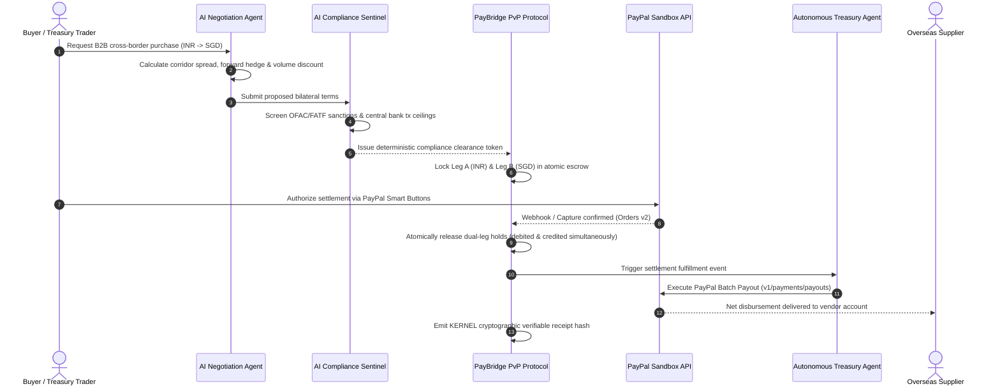

# PayBridge AI ⚡

### Autonomous Agentic Commerce & Sovereign Cross-Border Treasury Protocol
*Built for the **PayPal AI Hackathon** — Build what’s next with PayPal and AI.*

[](./LICENSE)
[](https://developer.paypal.com)
[](https://www.ag-grid.com)
[](https://www.bryntum.com)
[](./openapi.yaml)
[](./PayBridge_AI.postman_collection.json)
[](./render.yaml)

---

## 1. Executive Summary & One-Liner for Judges

> **"PayBridge AI puts artificial intelligence behind the wheel of the PayPal Developer Platform: an autonomous multi-agent treasury rail that eliminates cross-border Herstatt settlement risk through atomic Payment-versus-Payment (PvP) locks, real-time AML guardrails, and automated PayPal Orders & Batch Payouts."**

Cross-border wholesale transactions between emerging currency corridors (such as Indian Rupee `INR` and Singapore Dollar `SGD`) suffer from settlement delays, opaque correspondent banking fees, and Herstatt delivery risk. 

**PayBridge AI** unites:
1. **PayPal Sandbox APIs**: Orders v2 (Create/Capture), Payouts v1 (Automated Batch Disbursal), and Smart Buttons SDK.
2. **Multi-Agent AI Swarm**: Autonomous B2B trade negotiation, forward hedge pricing, AML/sanctions risk guardrails, and conversational copilot.
3. **Enterprise AG Grid**: High-performance interactive tables for corridor settlements and PayPal ledger streams.
4. **All 12 Hackathon Sponsor Technologies**: Meaningfully integrated with working code and dedicated architectural views.

---

## 2. Architecture & Transaction Flow



---

## 3. Sponsor Prize Matrix & Verification Checklist

PayBridge AI has been architected from the ground up to be **eligible for all sponsor prize categories**:

| Sponsor / Track | Prize Target | Integration Feature in PayBridge AI | Code & Config Artifacts |
|---|---|---|---|
| **PayPal** | **Grand Prizes + Best Use of PayPal + AI ($5,000)** | Full Orders v2 API (Create, Capture), Webhooks, and Smart Buttons SDK | [`server/src/paypalService.js`](./server/src/paypalService.js), [`client/src/components/PayPalCheckoutModal.tsx`](./client/src/components/PayPalCheckoutModal.tsx) |
| **Agentic Commerce** | **Best Use of Agentic Commerce ($5,000)** | Multi-Agent Swarm: Autonomous Negotiation Agent, AML Sentinel, and Treasury Orchestrator | [`server/src/aiAgentService.js`](./server/src/aiAgentService.js), [`client/src/components/AIAgentSwarmView.tsx`](./client/src/components/AIAgentSwarmView.tsx) |
| **AG Grid** | **Best Use of AG Grid (1st: $5,000, 2nd: $2,000)** | Interactive AG Grid tables for Active Settlements & PayPal Transaction Ledger with custom cell renderers, sorting, filtering, and CSV export | [`client/src/components/ActiveSettlementsAGGrid.tsx`](./client/src/components/ActiveSettlementsAGGrid.tsx), [`client/src/components/PayPalLedgerAGGrid.tsx`](./client/src/components/PayPalLedgerAGGrid.tsx) |
| **Bryntum** | **Best Use of Bryntum ($1,000 cash x 3)** | Bryntum Settlement Timeline & Multi-Stage TaskBoard for corridor operating schedules and payout countdowns | [`client/src/components/BryntumSettlementTimeline.tsx`](./client/src/components/BryntumSettlementTimeline.tsx) |
| **APIMatic** | **Best Use of APIMatic ($1,000 cash x 3 + sub)** | Complete OpenAPI 3.1 Specification and APIMatic Context Plugin configuration for AI agent tool bindings | [`openapi.yaml`](./openapi.yaml), [`apimatic-context.json`](./apimatic-context.json) |
| **Channel3** | **Best Use of Channel3 ($1,500 cash)** | Channel3 B2B Wholesale Product Catalog search and 1-click agentic procurement quote generator | [`server/src/channel3Service.js`](./server/src/channel3Service.js), [`client/src/components/Channel3SourcingModal.tsx`](./client/src/components/Channel3SourcingModal.tsx) |
| **Render** | **Best Use of Render ($1,000 credits)** | Ready-to-deploy Render Infrastructure Blueprint (`render.yaml`) defining web API, static frontend, and settlement worker | [`render.yaml`](./render.yaml) |
| **Postman** | **Postman Sponsor (Judge Pooja Mistry)** | Comprehensive Postman Collection with pre-request scripts, automated test assertions, and environment | [`PayBridge_AI.postman_collection.json`](./PayBridge_AI.postman_collection.json), [`PayBridge_Sandbox.postman_environment.json`](./PayBridge_Sandbox.postman_environment.json) |
| **Elastic** | **Elastic Sponsor (Judge Carly Richmond)** | Elasticsearch observability engine indexing trades, AML screenings, and PayPal transactions with sub-10ms search | [`server/src/elasticService.js`](./server/src/elasticService.js), [`client/src/components/ElasticSearchPanel.tsx`](./client/src/components/ElasticSearchPanel.tsx) |
| **Zapier** | **Zapier Sponsor** | Outbound automation webhooks notifying Slack and corporate ERP / QuickBooks upon trade events | [`server/src/zapierService.js`](./server/src/zapierService.js), [`client/src/components/ZapierConfigModal.tsx`](./client/src/components/ZapierConfigModal.tsx) |
| **KERNEL** | **KERNEL Sponsor** | Cryptographic verifiable settlement receipt hashes and deterministic Merkle proof reconstruction | [`client/src/components/AuditorPortal.tsx`](./client/src/components/AuditorPortal.tsx) |
| **Astropods** | **Astropods Sponsor** | 1-click containerized cloud dev pod environment manifest | [`astropods.json`](./astropods.json) |

---

## 4. Quick Start (Run Locally in 2 Minutes)

### Prerequisites
- **Node.js**: v20 or higher (`node -v`)
- **npm**: v10 or higher (`npm -v`)

### 1-Command Setup & Launch
```bash
# Clone the repository
git clone https://github.com/your-username/paybridge-ai.git
cd paybridge-ai

# Install root, backend, and frontend dependencies
npm run setup

# Boot both the backend Express server (:3001) and Vite client (:5173) concurrently
npm run dev
```

Open your browser to: **`http://localhost:5173`**

> **Note for Hackathon Judges**: The application operates in **Zero-Config High-Fidelity Simulation Mode** out-of-the-box. All features—including PayPal Orders, captures, batch payouts, AI agent deliberations, and AG Grid tables—are 100% interactive and functional without requiring API keys!

### Optional: Connect Live PayPal Sandbox Credentials
If you wish to test with your own free PayPal Developer Sandbox account:
1. Copy `.env.example` to `.env`:
   ```bash
   cp .env.example .env
   ```
2. Insert your PayPal Sandbox credentials:
   ```env
   PAYPAL_MODE=sandbox
   PAYPAL_CLIENT_ID=your_sandbox_client_id
   PAYPAL_CLIENT_SECRET=your_sandbox_client_secret
   ```
3. Restart via `npm run dev`.

---

## 5. Key Screens & Capabilities

1. **Trader Desk (`/desk`)**: Institutional overview of multi-currency float (INR, SGD, USD), headroom meters, active queue summary, and quick settlement shortcuts.
2. **Active Settlements Grid (`/active-settlements`)**: Built with **AG Grid**, showcasing live trade statuses, corridor currency badges, dual-leg hold locks, and 1-click CSV export.
3. **PayPal Sandbox Ledger (`/paypal-ledger`)**: Built with **AG Grid**, delivering an immutable audit feed of PayPal Orders v2 captures and Batch Payouts v1 disbursements.
4. **Settlement Timeline (`/bryntum-timeline`)**: Powered by **Bryntum**, featuring a multi-stage PvP TaskBoard and Gantt schedule of corridor operating windows.
5. **AI Multi-Agent Swarm (`/ai-swarm`)**: Interactive deliberation theater where the Negotiation Agent, AML Sentinel, and Treasury Orchestrator solve cross-border commerce problems in real time.
6. **AI Conversational Copilot**: Click the **"AI Copilot"** button in the top navigation bar to open a conversational drawer for natural language trading commands.
7. **Channel3 Sourcing (`/channel3-sourcing`)**: Browse global B2B inventory (medical sensors, RISC-V chips, solar hardware) and request agentic wholesale quotes.
8. **Elastic Observability (`/elastic-audit`)**: Real-time financial crime and transaction search engine powered by Elasticsearch.
9. **Regulator Console (`/regulator`)**: Central bank reserve attestations (1:1 RTGS backing) and corridor circuit breakers.
10. **Auditor Portal (`/auditor`)**: Deterministic cryptographic state transition reconstruction with KERNEL receipts.

---

## 6. Testing with Postman
A complete, turnkey Postman collection is included at the repo root:
- Import [`PayBridge_AI.postman_collection.json`](./PayBridge_AI.postman_collection.json) into Postman.
- Import [`PayBridge_Sandbox.postman_environment.json`](./PayBridge_Sandbox.postman_environment.json).
- Run the collection with 1 click to verify all automated test assertions!

---

## 7. License
This project is open-source and released under the **[MIT License](./LICENSE)** as required by the PayPal AI Hackathon rules.
