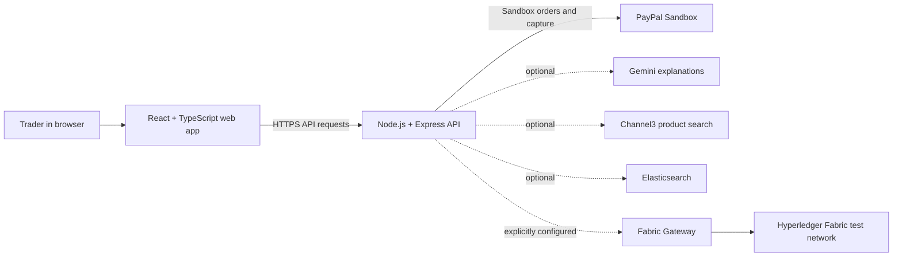

# PayBridge AI

<p align="center">
  <strong>AI-assisted cross-border trade workflows with transparent, human-approved payment steps.</strong>
</p>

<p align="center">
  <a href="https://paypal-hackathon-061h.onrender.com/">Open the demo</a> ·
  <a href="https://paybridge-api-8ua8.onrender.com/health">API health</a> ·
  <a href="./openapi.yaml">API specification</a>
</p>


PayBridge AI is a hackathon prototype for reviewing cross-border trade proposals. It combines illustrative FX benchmarks and deterministic demo checks with optional Gemini explanations and PayPal Sandbox checkout. A separate Hyperledger Fabric Gateway panel can query a test ledger and, when explicitly configured, submit test transactions.

> **Prototype notice:** This project is for demonstration and evaluation. It does not process real payments, provide live FX quotes, perform official sanctions screening, or make regulatory decisions. Do not use it with real funds or for production financial operations.

## How it works



The web app and API are separate services. The normal trade workflow uses an in-memory demo ledger. Fabric Gateway operations use the separate Fabric panel and do not automatically settle PayPal transactions.

## What the demo includes

- **Trade proposals:** Indicative proposals from static demo FX values and an illustrative volume heuristic.
- **Risk review:** Deterministic prototype corridor checks and a small built-in sample blocklist. Gemini can explain the result, but it does not make the decision.
- **PayPal Sandbox:** Optional order approval and capture with server-side verification of the captured amount against the demo quote. Without credentials, the app clearly labels the flow as a simulation.
- **Review trail:** In-memory demo events and a local SHA-256 receipt digest for inspecting the prototype workflow.
- **Fabric panel:** Optional live chaincode queries and guarded test writes for proposal, acceptance, regulator-endorsed settlement, and separate debit/credit legs.
- **Operations UI:** Trade and activity views powered by React, TypeScript, and AG Grid.

## Important boundaries

| Area | Current behavior |
| --- | --- |
| Ordinary trades | Stored in backend memory and lost when the API restarts or redeploys. |
| PayPal | Sandbox only; a capture does not automatically or atomically settle a Fabric trade. |
| FX and risk | Illustrative rates and prototype checks; not live quotes, official screening, compliance clearance, or financial advice. |
| Fabric blocks | The block explorer table and auditor use sample fixtures; live QSCC block decoding is not implemented. |
| Fabric writes | Disabled by default. When enabled, the API submits to the separate test ledger; balances must already be funded through authorized regulator operations. |
| Access control | `X-Operator` selects a demo view and is not authentication. The shared Fabric write token is not per-user or per-bank authorization. |

The Fabric backend holds both BankA1 and BankB1 signing identities when writes are enabled. This centralizes signing authority and is suitable only for a tightly controlled hackathon demonstration. The app does not connect PayPal capture to Fabric settlement.

## Run locally

### Requirements

- Node.js 20 or newer and npm
- Docker and Go only if you want to run the separate Fabric network and chaincode

### Install and start

From the repository root:

```bash
npm run setup
npm run dev
```

Open [http://localhost:5173](http://localhost:5173). The API listens on port `3001` by default.

To build the frontend:

```bash
npm run build
```

### Configure integrations

Copy `.env.example` to `.env` and set only the server-side integrations you plan to use. For the browser-based PayPal Sandbox button, copy `client/.env.example` to `client/.env` and set `VITE_PAYPAL_CLIENT_ID` to the **Sandbox client ID only**. Keep `PAYPAL_CLIENT_SECRET` in the backend environment. Restart the relevant server after changing environment variables.

| Integration | Environment variables | Notes |
| --- | --- | --- |
| PayPal | `PAYPAL_MODE`, `PAYPAL_CLIENT_ID`, `PAYPAL_CLIENT_SECRET` | Use Sandbox credentials. Missing credentials leave the app in simulation mode. |
| Gemini | `GEMINI_API_KEY`, `GEMINI_MODEL` | Explanations only; deterministic demo checks remain the decision source. |
| Channel3 | `CHANNEL3_API_KEY`, `CHANNEL3_API_URL` | Optional product sourcing. |
| Elasticsearch | `ELASTIC_ENDPOINT`, `ELASTIC_API_KEY` | Optional search and indexing. |
| Kernel / Zapier | `KERNEL_API_BASE`, `ZAPIER_MCP_SERVER_URL` | Optional integrations; configure only if used. |

Never put server credentials in `client/.env`, the frontend build, screenshots, or Git. Use `.env.example` as a template, not as a place to paste real values.

## Hyperledger Fabric Gateway

Fabric is a separate proof of concept under `chaincode/` and `network/`. The Gateway is disabled by default. Generated identities are intentionally excluded from Git; initialize the network using the scripts and instructions in `network/` before connecting an app.

### Live queries

Configure the API with the peer endpoint, channel and chaincode, TLS server name, TLS CA, MSP ID, and a rotated client identity. For an EC2-hosted test network, the Render API must be able to reach the peer on the configured port. The TLS server name must match a name in the peer certificate.

### Test writes

Writes require all of the following in the **backend environment**:

```text
FABRIC_GATEWAY_ENABLED=true
FABRIC_GATEWAY_WRITE_ENABLED=true
FABRIC_WRITE_API_TOKEN=<random secret with at least 32 characters>
FABRIC_BANKA1_CERT_BASE64=<rotated BankA1 certificate>
FABRIC_BANKA1_KEY_BASE64=<rotated BankA1 private key>
FABRIC_BANKB1_CERT_BASE64=<rotated BankB1 certificate>
FABRIC_BANKB1_KEY_BASE64=<rotated BankB1 private key>
FABRIC_TLS_CA_BASE64=<peer TLS CA certificate>
```

Also configure `FABRIC_HOST`, `FABRIC_PEER_PORT`, `FABRIC_TLS_SERVER_NAME`, `FABRIC_MSP_ID`, `FABRIC_CHANNEL`, and `FABRIC_CHAINCODE`. Keep private keys and the write token in the hosting provider’s secret manager. Do not reuse identities that were exposed or committed in the past. The browser asks an authorized operator for the write token and keeps it in page memory for that session.

Writes submit permanent test-ledger transactions. Trades need funded accounts and must satisfy the chaincode’s operating rules. Proposal details used by the counterparty are held in backend memory for up to 30 minutes, so keep one API instance running during the proposal/acceptance flow. If it restarts, re-propose the trade. Fabric writes are not linked to PayPal checkout or payout.

## Deploy on Render

Deploy the API and frontend as separate services:

### API web service

| Setting | Value |
| --- | --- |
| Root Directory | `server` |
| Build Command | `npm install` |
| Start Command | `npm start` |
| Health Check Path | `/health` |

Choose a paid always-on compute plan for a live presentation. Add backend integration credentials in the service’s Environment settings. Configure the Fabric variables above only after verifying that rotated test identities and peer network access are ready.

### Frontend Static Site

| Setting | Value |
| --- | --- |
| Root Directory | `client` |
| Build Command | `npm install && npm run build` |
| Publish Directory | `dist` |
| Environment variable | `VITE_API_URL=https://<your-api-service>.onrender.com` |

`VITE_API_URL` is included at build time. Rebuild the Static Site after changing it. The repository’s `render.yaml` provides an optional Blueprint for these services; review its service names and secret prompts before syncing it with an existing Render setup.

## Repository map

```text
client/       React + TypeScript frontend
server/       Express API and provider integrations
chaincode/    Go settlement chaincode and tests
network/      Hyperledger Fabric network and deployment scripts
openapi.yaml  API specification
DEMO_SCRIPT.md  Suggested two-minute walkthrough
SUBMISSION.md   Hackathon project summary
```

## Useful links

- [Live web app](https://paypal-hackathon-061h.onrender.com/)
- [API health endpoint](https://paybridge-api-8ua8.onrender.com/health)
- [OpenAPI specification](./openapi.yaml)
- [Demo walkthrough](./DEMO_SCRIPT.md)
- [Submission summary](./SUBMISSION.md)
- [MIT License](./LICENSE)

## Attribution

PayBridge AI is an independent prototype. It is not affiliated with or endorsed by PayPal, any central bank, or any financial regulator. Product and service names are used only to describe integrations.
