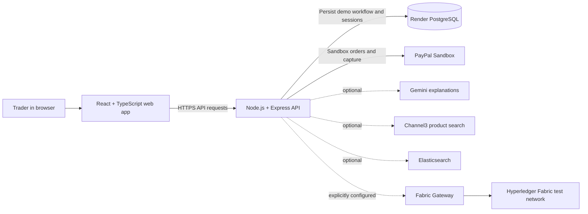

# CorridorFlow

<p align="center">
  <strong>AI-assisted cross-border trade workflows with transparent, human-approved payment steps.</strong>
</p>

<p align="center">
  <a href="https://paypal-hackathon-061h.onrender.com/">Open the demo</a> ·
  <a href="https://paybridge-api-8ua8.onrender.com/health">API health</a> ·
  <a href="https://corridorflow-api-docs.onrender.com/">API documentation</a> ·
  <a href="./openapi.yaml">API specification</a>
</p>


CorridorFlow is a hackathon prototype for reviewing cross-border trade proposals. It combines illustrative FX benchmarks and deterministic demo checks with optional Gemini explanations and PayPal Sandbox checkout. A separate Hyperledger Fabric Gateway panel can query a test ledger and, when explicitly configured, submit test transactions.

> **Prototype notice:** This project is for demonstration and evaluation. It does not process real payments, provide live FX quotes, perform official sanctions screening, or make regulatory decisions. Do not use it with real funds or for production financial operations.

## How it works



The web app and API are separate services. A Channel3 quote can prefill a trade; the API runs deterministic demo risk checks with an optional Gemini explanation, and records workflow events in Elasticsearch and Zapier when configured. After the counterparty accepts, PayPal Sandbox funding can be captured. The operator then links the accepted trade to Fabric, explicitly confirms Fabric settlement, and submits the chaincode's four separate value-leg transactions. These are sequential demo steps, not one atomic payment.

## What the demo includes

- **Trade proposals:** Indicative proposals from static demo FX values and an illustrative volume heuristic.
- **Risk review:** Deterministic prototype corridor checks and a small built-in sample blocklist. Gemini can explain the result, but it does not make the decision.
- **PayPal Sandbox:** Optional order approval and capture with server-side verification against the demo funding quote. Capture records funding only; it does not mark the trade settled or send an automatic payout.
- **Review trail:** PostgreSQL-backed demo trades, PayPal entries, refusals, and sessions when `DATABASE_URL` is configured, plus a local SHA-256 receipt digest.
- **Fabric panel:** Optional live chaincode queries and guarded test writes for proposal, acceptance, regulator-endorsed settlement, and separate debit/credit legs.
- **Operations UI:** Trade and activity views powered by React, TypeScript, and AG Grid.

## What is connected to Fabric?

Fabric is one optional subsystem inside the wider CorridorFlow demo. The components below do **not** all participate in a Fabric payment:

| Component | Connected to Fabric? | Role in this prototype |
| --- | --- | --- |
| Fabric Gateway + settlement chaincode | **Yes, when enabled** | Reads live chaincode state; guarded API actions can propose, accept, settle, and move test-ledger balances. |
| PayPal Sandbox | **Correlated, sequentially** | A verified Sandbox capture is required before a linked Fabric settlement can be submitted; it is not atomic with Fabric. |
| Gemini explanations and AI agents | **Pre-trade, advisory** | Deterministic demo rules run before proposal creation; Gemini can explain the result but never signs or submits Fabric transactions. |
| Channel3 product sourcing | **Quote to proposal** | A quote can prefill the terms of a trade. Live supplier identity and bank membership are not independently verified. |
| Elasticsearch | **Workflow observability** | Trade, risk, PayPal, and linked Fabric workflow events are indexed when configured; Elastic is not the authoritative ledger. |
| Kernel | **Limited / scenario only** | Browser sessions may be created through Kernel, but the storefront audit does not navigate to or inspect a live merchant DOM. |
| Zapier | **Workflow notifications** | Lifecycle events send to `ZAPIER_WEBHOOK_URL` when configured. `ZAPIER_MCP_SERVER_URL` is a different protocol and is not used as a Catch webhook. |
| AG Grid and settlement timeline | No | UI views for demo data; they are not ledger nodes or transaction processors. |
| Fabric block table and fixture auditor | No live block connection | These views use sample block fixtures. Live QSCC block retrieval and decoding are not implemented. |

The regular proposal and acceptance records are persisted in PostgreSQL when configured. The Fabric panel can link an accepted trade and require a completed PayPal capture before chaincode settlement. Chaincode settlement and each of the four value-leg writes are separate commits; a partial sequence needs operator reconciliation. This is a sequential hackathon demonstration, not a production payment rail.

## Important boundaries

| Area | Current behavior |
| --- | --- |
| Ordinary trades | Stored in PostgreSQL when `DATABASE_URL` is configured. Without it, the API uses temporary in-memory demo storage. |
| PayPal | Sandbox only; a capture does not automatically or atomically settle a Fabric trade. |
| FX and risk | Illustrative rates and prototype checks; not live quotes, official screening, compliance clearance, or financial advice. |
| Fabric blocks | The block explorer table and auditor use sample fixtures; live QSCC block decoding is not implemented. |
| Fabric writes | Disabled by default. When enabled, the API submits to the separate test ledger; balances must already be funded through authorized regulator operations. |
| Access control | Seven password-protected demo roles have separate workspaces and API permissions. Expiring session hashes are stored in PostgreSQL when configured. This is a prototype access layer, not a production identity system. Fabric writes also require the shared write token and chaincode authorization. |

The Fabric backend holds both BankA1 and BankB1 signing identities when writes are enabled. This centralizes signing authority and is suitable only for a tightly controlled hackathon demonstration. The linked workflow checks for a verified PayPal Sandbox capture before allowing Fabric settlement, but the two systems remain separate and cannot commit atomically.

## Run locally

### Requirements

- Node.js 20 or newer and npm
- Docker and Go only if you want to run the separate Fabric network and chaincode

### Install and start

From the repository root:

```bash
npm run setup
npm run dev
```

Open [http://localhost:5173](http://localhost:5173). The API listens on port `3001` by default.

The public landing page opens without a password. With PostgreSQL configured, the seven demo operators have individually hashed passwords in `paybridge_users`; sessions are stored in `paybridge_sessions` and expire after eight hours. On first database startup, the API imports passwords supplied through the server-only `PAYBRIDGE_PASSWORD_*` environment variables for missing operators. It does not overwrite existing database users. Without PostgreSQL, local development reads those variables directly.

| Role | Workspace | Main actions |
| --- | --- | --- |
| Bank A1 / Bank B1 trader | Trading desk | Propose demo trades, review settlements, explore sourcing and AI tools. |
| Bank A1 / Bank B1 approver | Settlement desk | Accept the counterparty's proposal, capture own-bank Sandbox funding, and submit authorized Fabric test writes with the separate write token. |
| RegA / RegB supervisor | Regulator console | Review own-jurisdiction sample rules, reserve, and refusals; inspect ledger information. |
| Consortium auditor | Receipt review | Inspect trade receipts, Fabric records, and activity search. |

To build the frontend:

```bash
npm run build
```

### APIMatic API portal

The APIMatic project uses the root `openapi.yaml` as its source of truth. Install the root dependencies, sign in to APIMatic once with `npx apimatic auth login`, then preview the interactive portal locally:

```bash
npm install
npm run apimatic:serve
```

Generate the static portal with `npm run apimatic:generate`. The generated `apimatic/portal` files are checked in and served by the Render static site, so Render does not need APIMatic credentials. Regenerate and commit those files whenever the API spec or portal content changes. Generate a TypeScript SDK with `npm run apimatic:sdk:typescript`; do not commit generated SDKs containing local configuration.

### Configure integrations

Copy `.env.example` to `.env` and set only the server-side integrations you plan to use. For the browser-based PayPal Sandbox button, copy `client/.env.example` to `client/.env` and set `VITE_PAYPAL_CLIENT_ID` to the **Sandbox client ID only**. Keep `PAYPAL_CLIENT_SECRET` in the backend environment. Restart the relevant server after changing environment variables.

Set `DATABASE_URL` on the API to use PostgreSQL. The API creates its `paybridge_records`, `paybridge_users`, and `paybridge_sessions` tables on startup, seeds demo fixtures only where absent, and loads stored workflow state before serving requests. Production startup requires `DATABASE_URL` and fails if the database cannot be reached. Local development can omit it and use temporary memory storage. `/health` reports `storageMode` and `databaseReady`. The Fabric ledger remains separate; PostgreSQL stores the app's local workflow and transient handoff data, not blockchain state. A PayPal provider call and a database write cannot be one atomic transaction, so interrupted provider operations still require operator reconciliation.

| Integration | Environment variables | Notes |
| --- | --- | --- |
| PostgreSQL | `DATABASE_URL` | Use the Render database's internal URL on the API service in the same workspace and region. |
| PayPal | `PAYPAL_MODE`, `PAYPAL_CLIENT_ID`, `PAYPAL_CLIENT_SECRET` | Use Sandbox credentials. Missing credentials leave the app in simulation mode. Capture does not settle Fabric. |
| Gemini | `GEMINI_API_KEY`, `GEMINI_MODEL` | Explanations only; deterministic demo checks remain the decision source. |
| Channel3 | `CHANNEL3_API_KEY`, `CHANNEL3_API_URL` | Optional product sourcing. |
| Elasticsearch | `ELASTIC_ENDPOINT`, `ELASTIC_API_KEY` | Optional search and indexing. |
| Kernel | `KERNEL_API_BASE`, `KERNEL_API_KEY` | Optional browser-session integration. The storefront audit remains a deterministic scenario, not live DOM inspection. |
| Zapier Catch | `ZAPIER_WEBHOOK_URL` | Optional outbound Catch webhook for lifecycle notifications. Configure it only in backend secrets. The UI cannot change the destination. |
| Zapier MCP | `ZAPIER_MCP_SERVER_URL` | Not currently used by this app; it is not a substitute for a Zapier Catch webhook. |

Use `GET /api/integrations/status` to inspect which integrations are configured and which are in simulation/fallback mode. “Configured” means environment settings exist; provider operations can still fail.

Never put server credentials in `client/.env`, the frontend build, screenshots, or Git. Use `.env.example` as a template, not as a place to paste real values.

## Local Hyperledger Fabric

The default development setup uses the Fabric network on this computer; AWS deployment files remain under `aws/`. Install Docker Desktop with the Linux engine running, Node.js, and Bash (on Windows use Git Bash or WSL with Docker integration). Run commands from the repository root.

For an existing initialized network, run `npm run fabric:start`, then restart the API. This starts the local peers and chaincode without removing their ledger volumes and generates `.env.fabric.local`, which makes the API connect to `127.0.0.1:9051`. Run `npm run fabric:stop` to stop the containers while retaining the ledger. `npm run fabric:configure` regenerates the local API configuration without starting containers.

For a **new, empty** local network, run `bash network/scripts/deploy-network.sh up` once, then `npm run fabric:configure` and start the API. The `deploy-network.sh up` command removes existing Compose volumes and regenerates identities: do not run it against a network whose ledger you want to keep. This creates five peer organizations, the settlement channel, and local chaincode. The generated `.env.fabric.local` contains a private write token and paths to local signing identities; it is Git-ignored. Use the token from that file when the UI requests it. Local settings take precedence over Fabric settings in `.env`; remove `.env.fabric.local` and restart the API to use an explicitly configured remote peer instead.

### Connect the Render API to local Fabric

A Render service cannot use your computer's `127.0.0.1`. Run a TCP tunnel that forwards to local port 9051 without terminating or replacing the Fabric peer TLS connection. For example, with an authenticated ngrok account and its agent installed, run `ngrok tcp 9051`. Ngrok TCP endpoints on its free plan require a verified payment method; a randomly assigned address can change when the tunnel restarts. Leave the tunnel and local Fabric running for the demo.

Copy the tunnel's `tcp://HOST:PORT` forwarding address and run `npm run fabric:render-config -- tcp://HOST:PORT`. This generates `.env.fabric.render` using the current local peer TLS CA and bank signing identities. It contains private keys and a write token, is Git-ignored, and must be treated as a secret. In the Render **API** service's Environment page, use **Add from .env** to import this file, then save and deploy. Keep `FABRIC_TLS_SERVER_NAME` as the peer name: it verifies the peer certificate through the tunnel. If the endpoint or generated identities change, regenerate the file and update Render. Do not expose the other Fabric ports to the internet.

The API on Render holds demo signing keys when writes are enabled. Restrict access to Render's environment and use this setup only for a test network. This is separate from the local `.env.fabric.local` profile. The Render site cannot reach Fabric until the tunnel is online and the Render environment is updated.

## Hyperledger Fabric Gateway

Fabric is a separate proof of concept under `chaincode/` and `network/`. Generated identities are excluded from Git. Use the local setup above to initialize the network and configure the Gateway.

### Live queries

Configure the API with the peer endpoint, channel and chaincode, TLS server name, TLS CA, MSP ID, and a rotated client identity. For an EC2-hosted test network, the Render API must be able to reach the peer on the configured port. The TLS server name must match a name in the peer certificate.

### Test writes

Writes require all of the following in the **backend environment**:

```text
FABRIC_GATEWAY_ENABLED=true
FABRIC_GATEWAY_WRITE_ENABLED=true
FABRIC_WRITE_API_TOKEN=<random secret with at least 32 characters>
FABRIC_BANKA1_CERT_BASE64=<rotated BankA1 certificate>
FABRIC_BANKA1_KEY_BASE64=<rotated BankA1 private key>
FABRIC_BANKB1_CERT_BASE64=<rotated BankB1 certificate>
FABRIC_BANKB1_KEY_BASE64=<rotated BankB1 private key>
FABRIC_TLS_CA_BASE64=<peer TLS CA certificate>
```

Also configure `FABRIC_HOST`, `FABRIC_PEER_PORT`, `FABRIC_TLS_SERVER_NAME`, `FABRIC_MSP_ID`, `FABRIC_CHANNEL`, and `FABRIC_CHAINCODE`. Keep private keys and the write token in the hosting provider’s secret manager. Do not reuse identities that were exposed or committed in the past. The browser asks an authorized operator for the write token and keeps it in page memory for that session.

Writes submit permanent test-ledger transactions. For a linked flow, create and accept the Fabric proposal, capture the linked PayPal Sandbox order, then explicitly confirm Fabric settlement. Commit all four value legs afterward; the app only labels the local workflow settled once all four commits have succeeded. Each call is a separate ledger transaction and a failure can leave partial state. Trades need funded accounts and must satisfy chaincode rules. Proposal details used by the counterparty are persisted in PostgreSQL when configured; the chaincode acceptance deadline still applies. This sequence is a prototype and does not make PayPal and Fabric atomic.

## Deploy on Render

Deploy the API and frontend as separate services:

### API web service

| Setting | Value |
| --- | --- |
| Root Directory | `server` |
| Build Command | `npm install` |
| Start Command | `npm start` |
| Health Check Path | `/health` |

Choose a paid always-on compute plan for a live presentation. Add backend integration credentials in the service’s Environment settings. Configure the Fabric variables above only after verifying that rotated test identities and peer network access are ready.

Add `DATABASE_URL` to this API service's Environment settings using the **internal** connection URL of your existing Render Postgres database. The API and database must be in the same Render workspace and region. Do not put the URL in the frontend environment or commit it to Git. The API also maps a matching Virginia Render external database hostname to its private hostname when running on Render, which avoids the self-signed certificate error from `sslmode=verify-full` on private connections. Deploy the API, then check that `/health` returns `storageMode: "postgresql"` and `databaseReady: true`.

Set each `PAYBRIDGE_PASSWORD_*` variable on the API before the first database startup to provision missing operators. Changing those variables later does not replace database passwords. The landing page stays public; all business API routes require a session. Run one API instance for this prototype because active trade objects are also cached in process memory between database writes.

### Frontend Static Site

| Setting | Value |
| --- | --- |
| Root Directory | `client` |
| Build Command | `npm install && npm run build` |
| Publish Directory | `dist` |
| Environment variable | `VITE_API_URL=https://<your-api-service>.onrender.com` |

`VITE_API_URL` is included at build time. Rebuild the Static Site after changing it. The repository’s `render.yaml` provides an optional Blueprint for these services; review its service names and secret prompts before syncing it with an existing Render setup.

## Repository map

```text
client/       React + TypeScript frontend
server/       Express API and provider integrations
chaincode/    Go settlement chaincode and tests
network/      Hyperledger Fabric network and deployment scripts
openapi.yaml  API specification
DEMO_SCRIPT.md  Suggested two-minute walkthrough
SUBMISSION.md   Hackathon project summary
```

## Useful links

- [Live web app](https://paypal-hackathon-061h.onrender.com/)
- [API health endpoint](https://paybridge-api-8ua8.onrender.com/health)
- [OpenAPI specification](./openapi.yaml)
- [Demo walkthrough](./DEMO_SCRIPT.md)
- [Submission summary](./SUBMISSION.md)
- [MIT License](./LICENSE)

## Attribution

CorridorFlow is an independent prototype. It is not affiliated with or endorsed by PayPal, any central bank, or any financial regulator. Product and service names are used only to describe integrations.
